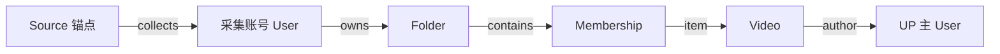

# B 站收藏资料契约

本契约由 `inkcre/bilibili` 拥有，约束 Web 与 Python Distribution 对同一份收藏资料的解释。
Web Distribution 提供浏览器 Source 和阅读视图，Python Distribution 提供读取及既有词法维护所需的投影。
采集与读取分别取决于执行 Peer 的能力；任何 Distribution 都不拥有其他 Peer 或共享信息。

## 范围与身份

首版采集用户明确选择的、自建的视频收藏夹，包含当前登录账号可访问的私密收藏夹。
账号确认和浏览器绑定属于执行范围，不构成 info-base 的租户或行级权限。
稍后再看、收藏他人的收藏夹、视频二进制、字幕和评论不在首版保存范围内。

| 记录 | 精确 Resolver | 身份及内容 |
| --- | --- | --- |
| User | `extensions.bilibili.user.v1` | `mid` 为十进制字符串；名称和头像 URL 为已取得的可选字段。 |
| Folder | `extensions.bilibili.folder.v1` | `id` 为完整 media_id 的十进制字符串；保留已知标题、简介、私密标记和来源报告数量。不能用原始 folder fid 替代此身份。 |
| Video | `extensions.bilibili.video.v1` | `aid` 为十进制字符串，BVID 是已知时保存的别名；保留已知标题、简介、时长、发布时间和封面 URL。多 P 不拆成多份收藏。 |
| Membership | `extensions.bilibili.membership.v1` | 身份由所属收藏夹与视频决定；保存此次观察的可用性、收藏时间和观察时间。页码与页内位置只描述本次分页观察，不声称原站绝对顺序。 |

这些记录的 content 为结构化 JSON。跨实体关联以 Relation 为唯一事实，不在记录中复制关联 ID。
原生 ID 不使用名称、标题或不安全的 JavaScript 数字替代。未知字段缺省；失效占位标题不覆盖已有标题或简介。
已取得的文字和身份在源站内容失效后继续保留，封面 URL 不承诺远程图片长期可用。

## 图与合并

`Source.block` 保持指向该 Source 独占的 `core.source.v1` 锚点，不能指向多个 Source 共用的账号 Block。
不同 Source 可通过各自的出处边指向相同原生记录。同一视频属于多个收藏夹时，共用 Video，分别保留 Membership。

扩展按精确 Resolver 和原生身份查找、合并普通图中的既有记录；Membership 通过所属 Folder
及其 `item` 关系指向的 Video 定位。顺序重复采集复用已有 Block，包括其他 Distribution
写入的同一原生对象，不改动用户组织关系。未观察到条目不能被解释为取消收藏或删除资料。
可变成员事实保存在 Membership 中，关系内容保持稳定。

采集确认本页必需的 Block 与 Relation 写入成功后，才推进 Source 进度。中断可以留下已写入的部分图，
下次采集核对已有记录并补齐；不承诺整页原子可见或不同 Source 并发首次创建时的身份唯一性。

## 完整性与后续使用

来源的 `has_more` 决定分页终点，短页不能被当作末尾。续传复核首批和已提交边界，末批复核列表头部及报告数量；
观察到变化时明确停止或重新扫描，不把永久页码当身份游标。源站隐藏条目、失效项或实时变化造成的数量差额需要解释，
分页遍历结束不等于取得某一时刻的原子完整快照。未知写入结果不自动重放，应重读图和进度核实。

各 Distribution 读取已有图并按其能力提供标签、正文和导航，不在读取或索引时访问 B 站补抓内容。
词法记录由既有索引维护拥有；提供 Resolver 文本投影不等于索引已经完成。
原采集浏览器离线后，其他已加载对应 Resolver 的 Peer 仍能读取文字与关系。
独立原生发行版本不要求数字一致，但必须支持上述精确 Resolver 合同。
